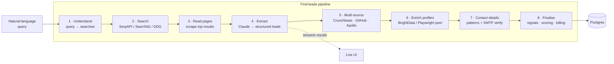

<div align="center">

# Prospecting

**An AI prospecting engine that finds B2B leads, verifies how to reach them,
and tells you when they're ready to buy.**

Describe your ideal customer in plain English. Get back scored, enriched,
deliverability-checked leads — and a live feed of the buying signals that say
*now* is the time to reach out.


[Features](#features) · [How it works](#how-it-works) · [Quick start](#quick-start) · [Architecture](#architecture) · [Engineering notes](#engineering-notes)

</div>

---

## Why

Most prospecting tools sell you a static database: the same stale list
everyone else is emailing. This engine works the other way round. It searches
the live web for companies that match your criteria, reads their pages,
extracts the people who matter, works out how to contact them, and checks the
address actually accepts mail — before you ever hit send.

Then it keeps watching. Funding rounds, executive hires, new job postings,
competitor tech being ripped out, frustrated posts about a rival product: each
one is a reason to reach out, and each one is scored.

## Features

### 🔎 Find leads from a sentence
Type *"Series A fintech companies in Bangalore hiring their first sales
lead"* and an **eight-phase pipeline** turns it into search queries, reads the
results, and extracts structured leads. Results stream into the UI as they
arrive — cards appear and fill in, rather than you watching a spinner.

### ✉️ Contact details you can trust
Email discovery that goes past guessing:
- Contact-page scraping, then **pattern generation** (`first.last@`, `flast@`, …)
- **SMTP mailbox verification**, in-process or through a remote verifier fleet
- **Catch-all detection**, so an address a domain accepts blindly isn't reported as verified
- Disposable-domain filtering from a list that syncs on a schedule
- Phone parsing and normalisation via `libphonenumber`

### 📡 Buying-intent signals
Background sweeps watch for the moments that matter:

| Signal | Source |
|---|---|
| Funding rounds | SEC EDGAR S-1 / 8-K filings, funding news |
| Executive changes | Leadership moves at target accounts |
| Hiring intent | Job postings for the roles you sell to |
| Tech-stack changes | Competitor tools added or removed from a site |
| New domains | Fresh registrations matching your ICP (via Certificate Transparency) |
| Social listening | Public complaints about competitor products |
| Review signals | 1–2★ reviews of competitor products on G2, Capterra and TrustRadius |

Every signal is scored, so the feed surfaces what's worth acting on first.

### 🎯 ICP scoring
Define your ideal customer profile once. Every lead gets an LLM-assessed fit
score with the reasoning attached, not just a number.

### 📨 Outreach sequences
Multi-step sequences with enrollment, scheduling and AI-personalised drafts.
The scheduler claims due steps with `FOR UPDATE SKIP LOCKED`, so two runners
can never send the same step twice.

### 📥 Import, dedupe, undo
CSV, JSON or a list of LinkedIn URLs. Large imports report progress over
Server-Sent Events, duplicates are detected on the way in, and any batch can
be **undone within 24 hours**.

### 🔌 Runs on whatever keys you have
**28 discovery providers**, every one optional. Unconfigured providers
self-skip — nothing throws, you just get less enrichment. With nothing but a
database you still get DuckDuckGo search, Certificate Transparency, Hacker
News and RSS sweeps. `GET /api/health` reports exactly what's live.

## How it works



`POST /api/prospects/find-leads` creates a job and returns in under a second.
The pipeline runs in the background and the client polls for progress. That
split is deliberate: a deep run takes 60–150 seconds, longer than a typical
platform request timeout.

Failures collapse into **five user-facing error codes**, so the UI can say
*"our search provider is briefly unavailable"* instead of showing a stack
trace. And credits are charged only **after** work succeeds — a failed run
costs nothing, and a run that would exceed the balance returns what the
balance affords rather than failing outright.

## Quick start

**Prerequisites:** Node.js 20+, Docker.

```bash
git clone https://github.com/Nanduvamshi/ai-prospecting-engine.git
cd ai-prospecting-engine

cp .env.example .env            # add ANTHROPIC_API_KEY for the full pipeline
docker compose up -d db         # Postgres on host port 5433
npm install
npm run db:migrate
npm run db:seed                 # optional sample data
npm run dev                     # → http://localhost:3000
```

No cloud account and no credentials are needed to run it locally. Auth runs in
`dev` mode with a fixed user.

> **Why port 5433?** A locally installed Postgres usually already holds 5432.
> The container starts fine, connections silently reach the wrong server, and
> it's miserable to debug. Inside the compose network the app still uses
> `db:5432`.

### What each key unlocks

| Configuration | What you get |
|---|---|
| `DATABASE_URL` only | App boots, seeded data renders, keyless sweeps run |
| **`+ ANTHROPIC_API_KEY`** | **The core find-leads loop.** Lead extraction is an LLM step — this is the key that matters |
| `+ SERPAPI_API_KEY` or `SEARXNG_URL` | Much better search recall in phase 2 |
| `+ BrightData / Apollo / Bouncer / …` | Progressively deeper enrichment and verification |

Self-hosted search is one command away:

```bash
docker compose --profile search up -d searxng    # → SEARXNG_URL=http://localhost:8888
```

## Architecture

```
src/
  app/              Next.js App Router — UI under (app)/, 45 API routes under api/
  components/       UI components
  lib/              Client-safe helpers only
  server/           Server-only — every barrel starts with `import 'server-only'`
    db/             Drizzle schema (22 tables), pooled client, keyset cursors
    auth/           Cognito JWT verification + dev bypass
    ai/             Provider router — Anthropic, OpenAI, Bedrock
    discovery/      28 search, enrichment, verification and signal providers
    pipeline/       The eight-phase find-leads runner
    prospects/      Records, scoring, dedupe, import / export
    icp/            ICP storage and LLM fit scoring
    outreach/       Sequences, enrollments, personalised drafting
    ingestion/      Public-data adapters (SEC, GitHub, Crunchbase, job boards)
    network/        Opt-in cross-org contact graph
    billing/        BillingProvider seam (no-op by default)
    email/          EmailSender seam (log-only by default)
infra/              AWS CDK — Cognito, VPC + Postgres, App Runner, EventBridge
tests/              Jest unit tests
```

**Stack:** Next.js 16 · React 19 · TypeScript (strict) · PostgreSQL 17 ·
Drizzle ORM · Tailwind CSS 4 · Anthropic Claude · Zod · AWS CDK.

### Deployment

Four CDK stacks describe the production setup:

| Stack | Provisions |
|---|---|
| `auth` | Cognito user pool, plus a trigger that assigns each user an org |
| `data` | VPC, Postgres in private subnets, generated credentials in Secrets Manager |
| `app` | ECR repository and an App Runner service |
| `cron` | Eight EventBridge schedules driving the signal sweeps and sequence runner |

Migrations run at boot behind a Postgres advisory lock, so concurrent
instances start safely. See [`infra/README.md`](infra/README.md) for the
deploy walkthrough.

## Engineering notes

A few decisions that shaped the codebase:

**Seams, not vendors.** Billing, email delivery and AI are interfaces with
safe defaults. The pipeline never talks to a payment processor or mail
service directly, so either can be swapped without touching it.

**Keyset pagination.** Cursors, not offsets — page 500 costs the
same as page 1, and rows don't shift under you while you scroll.

**Integers for scores.** Sorting a composite string like `"<score>#<id>"`
puts `"9#x"` after `"85#y"`. Scores are real integers with a proper index.

**One statement for erasure.** Removing a user's contact-graph contributions
is a single SQL statement, not a table scan followed by batched deletes.

**Strict types, no escape hatches.** `ignoreBuildErrors` stays off. Enabling
strict builds early on surfaced an undefined variable in the pipeline and
twenty routes returning plain objects instead of `Response`s.

**The server boundary is enforced.** `server/` imports `server-only`, so
pulling a database driver into a client component is a build error, not a
surprise in the browser bundle.

## Scripts

| Command | What it does |
|---|---|
| `npm run dev` | Development server |
| `npm run build` | Type-checked production build |
| `npm run typecheck` | Strict TypeScript check |
| `npm test` | Unit tests (Jest) |
| `npm run verify:stores` | Contract checks for every repository against a real database |
| `npm run db:generate` | Generate a migration from schema changes |
| `npm run db:migrate` | Apply migrations |
| `npm run db:seed` | Seed development data |
| `npm run db:studio` | Browse the database in Drizzle Studio |
| `npm run pipeline` | Run the find-leads pipeline from the command line |

CLI scripts run with `--conditions react-server`; without it, the
`server-only` marker throws outside a Next build.

## Roadmap

- [ ] Hosted sign-in flow for Cognito mode (local `dev` auth works today)
- [ ] SMTP delivery for sequences — steps are recorded but not yet sent
- [ ] UI for enrichment provenance, intent-signal detail and outreach drafts
- [ ] Public lead-finder page (the API is built and rate-limited)
- [ ] LinkedIn and Reddit lead sources behind the existing `LeadSource` seam
- [ ] First production deployment of the CDK stacks
